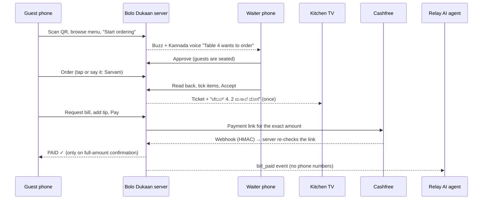
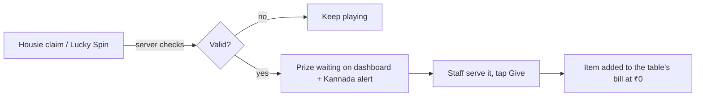
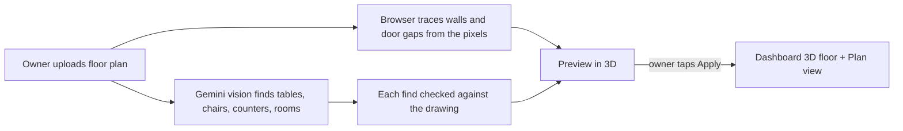

<div align="center">



# Bolo Dukaan for Restaurants

**Every table, talking to you.**

Set up a restaurant in minutes and get a live dashboard plus a QR code for every table.<br>
Guests browse, order and pay from their phones by tapping **or just talking** in Kannada, Hindi or English.<br>
Waiters work from their own phones, the kitchen gets a big-screen display, and the owner sees everything from one screen.


</div>

---

## Contents

- [What it does](#what-it-does)
- [Voice and AI: Sarvam](#voice-and-ai-sarvam)
- [Features](#features)
- [Pages and who uses them](#pages-and-who-uses-them)
- [Quick start (Windows)](#quick-start-windows)
- [Configuration and switches](#configuration-and-switches)
- [Restaurant upgrades in detail](#restaurant-upgrades-in-detail)
- [Games that matter to the bill](#games-that-matter-to-the-bill)
- [Automations](#automations)
- [Blueprint to 3D (Gemini vision)](#blueprint-to-3d-gemini-vision)
- [Payments with Cashfree](#payments-with-cashfree)
- [Relay AI agent](#relay-ai-agent)
- [Supermarket mode, 3D aisle finder and AI Meal Planner](#supermarket-mode-3d-aisle-finder-and-ai-meal-planner)
- [How a table works](#how-a-table-works)
- [Security](#security)
- [Architecture](#architecture)
- [API reference](#api-reference)
- [Project structure](#project-structure)
- [Tests](#tests)
- [Demo script (4 minutes)](#demo-script-4-minutes)
- [Troubleshooting](#troubleshooting)
- [License](#license)

---

## What it does

| | |
|---|---|
| 📸 **Owner** | Signs up (email or Google), snaps a photo of the paper menu, sets tables and chairs, optionally uploads a floor plan, prints QR codes, adds waiters, and downloads a daily report. |
| 📱 **Guest** | Scans the table QR, browses the menu at once, taps a dish for photos and nutrition, orders by tapping or speaking once the waiter confirms the table, calls a waiter for exactly what they need, plays games, and pays by UPI or shares the bill on WhatsApp. |
| 🧑‍🍳 **Waiter** | Logs in on their own phone with a PIN, sees only their tables, approves seated guests, reads each order back before sending it to the kitchen, marks food served and merges tables for big groups. |
| 📺 **Kitchen** | A no-touch TV showing accepted orders as big tickets with timers, and reads each new order aloud in Kannada. |
| 🖥️ **Cashier** | Sees every table colour-coded in a grid, a blueprint plan or a 3D floor, hears spoken alerts in the kitchen's language and closes bills. |

## Voice and AI: Sarvam

All voice and language features run on **[Sarvam AI](https://www.sarvam.ai)**, built for Indian languages. Gemini is a backup for those, and is used on its own for one job Sarvam doesn't do: **reading a floor-plan image** (see [Blueprint to 3D](#blueprint-to-3d-gemini-vision)).

| Job | Sarvam model |
|---|---|
| Speech to text (guest orders, owner questions, shopper requests, hands-free cooking) | **Saaras** (`saaras:v4`) |
| Kannada / Hindi / English voice (kitchen and dashboard alerts, replies, recipe read-aloud) | **Bulbul** (`bulbul:v3`) |
| Understanding orders, budgets, owner questions and price lists; translating recipe steps | **Sarvam chat model** (`sarvam-105b`) |
| Reading a photo or PDF of a menu or price list | **Sarvam Document Intelligence** |

**Ground rules, enforced in code:** the AI never decides money (prices, totals, availability and payment status come from the database), nothing is ordered or saved until a person taps confirm, every AI call has a 15-second timeout with a tap fallback, and spoken alerts use **fixed phrases** so the words are always right. See [SARVAM_FEATURES.md](SARVAM_FEATURES.md).

## Features

**For the owner**
- Sign up / log in with **email + password** or **Sign in with Google**; choose **Restaurant** or **Supermarket**
- **Menu from a photo or PDF**: Sarvam reads every dish, local-script name and price; the owner reviews before saving
- Menu by **CSV** (Excel "Save as CSV" works) or typed one by one, with optional description, veg/non-veg, spice level, allergens and nutrition
- **Tables and chairs**: type or tap the number of tables, set chairs per table or "__ chairs for all tables"
- **Optional floor plan**: upload a blueprint and the app **reads it** (walls traced from the drawing, tables, chairs, counters and rooms found by Gemini), then builds the same floor in 3D after you tap Apply
- **Printable QR cards** with seats, Wi-Fi details and captions in Kannada and Hindi
- **Staff**: add waiters with a username and PIN, assign tables, reset PINs, deactivate
- **Daily report**: download a CSV or save a clean printable page as PDF
- **Kitchen display link** for any TV or tablet, with a "Regenerate" button

**For guests**
- **Menu preview** right after scanning; ordering opens once the waiter confirms the table
- **Dish details**: photo, description, spice, allergens and a nutrition ring (kcal) with protein/carbs/fat bars, always labelled approx. and never guessed
- **Voice ordering**: say "eradu masala dose, ondu coffee", "ಎರಡು ಇಡ್ಲಿ ವಡೆ" or "do chai aur ek samosa" and get a proposed cart at menu prices
- **Order by budget**: "₹800, dinner for 4" builds a cart in code (no AI) that never goes over budget
- **Call a waiter for something specific** (water, cutlery, clean the table, help to order, extra chutney, or type it), see it's on the way, cancel it, and get a tick when it's done
- **Shared table**: friends join with a 4-digit code and all phones share one bill
- **Receipt-style bill** with **Share on WhatsApp**, an optional **tip** (5 / 10 / 15 % or any amount), UPI payment through **Cashfree**, and **split the bill** equally or by items
- **Games**: "Play with all tables" (live Table Quiz with a free-tea prize and today's leaderboard) or **"Play with my table"** (a private trivia room with its own QR), plus Rickshaw Rush, Dosa Flip, Chai Catch and Spice Match

**For the cashier**
- Live **grid**, a **blueprint plan view** and an interactive **3D restaurant floor** (Three.js) with glowing status rings, real table positions and the right number of chairs
- Approve / reject tables, accept / reject / preparing / served, paid in cash, free table, **merge tables**
- **Spoken alerts** in Kannada, Hindi or English via Sarvam Bulbul, with browser-voice and text fallbacks
- **Sales summary**: collected today, bills, average, UPI vs cash, top items; shows who approved a table and who accepted an order
- **Owner voice assistant**: "aaj ka collection?", "how many tables are free?", "free table 4" (actions ask for a tap first)
- **Relay AI agent** (optional): paid bills, waiter calls and the daily report go to your Relay.app workflow, where an AI agent can summarise, alert or log them

**Built for Windows**
- Double-click `start.bat`. It needs only Python and **one pure-Python package** (`qrcode`). The web server, database and HTTPS calls use Python's standard library, so Windows **Smart App Control** never blocks a compiled file.

## Pages and who uses them

| URL | Who | What |
|---|---|---|
| `/owner/signup` · `/owner/login` | Owner | Account (email or Google) |
| `/owner/setup` | Owner | Name, tables, chairs per table, kitchen language, Wi-Fi |
| `/owner/menu` | Owner | Menu: photo / CSV / typed, dish details |
| `/owner/qr` | Owner | Printable table QR cards |
| `/owner/floor` | Owner | Optional blueprint + drag tables, with a 3D preview |
| `/owner/staff` | Owner | Waiter accounts and their tables |
| `/owner/report` | Owner | Daily report, CSV download, Save as PDF |
| `/dashboard` | Owner / cashier | Live tables: grid, plan, 3D floor |
| `/t/<table>` | Guest | Menu, order, games, bill, pay |
| `/g/<room>` | Guests at one table | Private trivia room (game only) |
| `/staff/login` · `/waiter` | Waiter | PIN login and the waiter portal |
| `/kitchen/<secret>` | Kitchen TV | Accepted orders, no touching needed |
| `/store` · `/s/<store>` | Supermarket | Store dashboard and the customer shop |

## Quick start (Windows)

1. Install **Python 3.10+** from [python.org](https://www.python.org/downloads/) and tick **"Add python.exe to PATH"**.
2. Put this folder at a **short path**, e.g. `C:\Users\you\bolo-dukaan` (Windows has a 260-character path limit).
3. Double-click **`start.bat`**. The first run creates a private `.venv`, installs `qrcode` and creates `.env`.
4. Open `.env` in Notepad, add your keys (see [Configuration](#configuration-and-switches)), then run `start.bat` again.
5. Test the keys: `.venv\Scripts\python.exe scripts\check_sarvam.py` checks Sarvam (speech, voice, chat, document reading); `check.bat` checks the Gemini backup and makes a ₹1 Cashfree sandbox link.
6. For phones, run **`ngrok.bat`** in a second window. The app detects the HTTPS link by itself. Open **QR codes → Refresh links**.

```powershell
.\start.bat                 # http://localhost:8000
.\start.bat -Port 8001      # if port 8000 is busy
.\ngrok.bat 8001            # public HTTPS link for that port
```

<details>
<summary>macOS / Linux</summary>

```bash
python3 -m venv .venv && . .venv/bin/activate
pip install -r requirements.txt
cp .env.example .env        # add your keys
python run.py --port 8000
```
</details>

## Configuration and switches

Everything lives in `.env` (never commit it; it's in `.gitignore`). Restart after changes.

| Variable | Purpose |
|---|---|
| `SARVAM_API_KEY` | **Main voice and AI**: Saaras speech-to-text, Bulbul voice, sarvam-105b chat, Document Intelligence. Get one at [dashboard.sarvam.ai](https://dashboard.sarvam.ai) |
| `SARVAM_TTS_SPEAKER` · `SARVAM_TIMEOUT` | Voice (default `kavya`) and call timeout (default 15 s) |
| `GEMINI_API_KEY` | Reads floor-plan images; backup if a Sarvam call fails. [aistudio.google.com/apikey](https://aistudio.google.com/apikey) |
| `GEMINI_VISION_MODEL` | Optional model for blueprint reading. If the main model's free quota runs out, the app falls back to `gemini-3.5-flash-lite` (its own quota) |
| `RELAY_WEBHOOK_URL` | Optional: the Webhook-trigger URL of your Relay.app workflow (`https://hook.relay.app/...`) |
| `GOOGLE_CLIENT_ID` | Sign in with Google. Create an OAuth **Web application** client in [Google Cloud Console](https://console.cloud.google.com/apis/credentials) and add your origins |
| `CASHFREE_APP_ID` / `CASHFREE_SECRET_KEY` / `CASHFREE_ENV` | Payment links. Use **sandbox** keys from the Cashfree merchant dashboard |
| `PUBLIC_URL` | Optional fixed public URL; leave empty to auto-detect ngrok |

**Feature switches.** Each feature can be turned off with `false` and a restart. `FEATURE_MENU_PREVIEW` and `FEATURE_SEATS` are **on** by default; all others are **off** unless set to `true`. With the new switches off, the demo works exactly as before.

| Switch | Feature | When off |
|---|---|---|
| `FEATURE_KANNADA_ALERTS` | Spoken Kannada alerts (dashboard, kitchen, waiter) | Text + chime |
| `FEATURE_VOICE_ORDER` | Mic ordering at the table and in the shop | Tap to order |
| `FEATURE_VOICE_ACTIONS` | Voice "bill" / "waiter" | Buttons |
| `FEATURE_MENU_PHOTO` | Menu / price-list photo → draft | CSV / typed |
| `FEATURE_BUDGET_ORDER` | "₹800 for 4" basket (pure code) | Order normally |
| `FEATURE_TABLE_QUIZ` | Live quiz between tables, free tea prize | Other games |
| `FEATURE_SALES_SUMMARY` | Today's sales strip + bill list | Dashboard totals |
| `FEATURE_SPLIT_BILL` | Split equally / by items, one UPI link per person | One bill |
| `FEATURE_OWNER_VOICE` | Owner voice assistant | Dashboard buttons |
| `FEATURE_NUTRITION` | Approx. kcal / protein / carbs / fat from IFCT/NIN data | Prices only |
| `FEATURE_PHOTOS` | Real food & grocery photos (Wikimedia Commons) | Emoji |
| `FEATURE_MENU_PREVIEW` | Browse the menu before approval (default **on**) | Waiting screen |
| `FEATURE_SEATS` | Chairs per table everywhere (default **on**) | Tables only |
| `FEATURE_DISH_DETAILS` | Dish details sheet + owner dish fields | Menu cards only |
| `FEATURE_KITCHEN_TV` | Kitchen display + kitchen voice | Dashboard only |
| `FEATURE_STAFF` | Waiter accounts and portal | Owner does everything |
| `FEATURE_MERGE_TABLES` | Merge two tables for a big group | Separate bills |
| `FEATURE_GAME_ROOMS` | "Play with my table" private trivia | Restaurant-wide games |
| `FEATURE_FLOOR_PLAN` | Blueprint + table positions, plan view, 3D layout | Auto layout |
| `FEATURE_ROULETTE` | Bill Roulette: the table finds out who pays | Pay as usual |
| `FEATURE_HOUSIE` | Live Housie (tambola) for the whole restaurant; line → free juice, full house → free starter | Other games |
| `FEATURE_LUCKY_SPIN` + `LUCKY_SPIN_MIN_RUPEES` | Spin the wheel once the table's accepted bill reaches the amount (default ₹300) | No wheel |
| `FEATURE_AISLE_FINDER` | Supermarket: 3D store map with the product's aisle, side, bay and shelf | Search only |
| `FEATURE_STORAGE_FINDER` | Restaurant: 📦 Storage room on the owner site, 3D map of the store room (covers, utensils, vegetables…) | Hidden |
| `FEATURE_FLOOR_AI` | Read the blueprint: walls from the drawing, tables/counters/rooms with Gemini (needs `GEMINI_API_KEY`) | Walls only; drag tables by hand |
| `FEATURE_TIPS` | Tip chips on the guest bill, added to the Cashfree UPI amount | No tip option |
| `FEATURE_RELAY` | Send events to a Relay.app AI agent (needs `RELAY_WEBHOOK_URL`) | Nothing is sent |
| `FEATURE_DAILY_REPORT` | CSV + printable daily report | Sales strip |
| `FEATURE_SUPERMARKET` · `FEATURE_MEAL_PLANNER` | Supermarket mode and the meal planner | Restaurant only |
| `FEATURE_GEMINI_TTS` | Allow Gemini's voice as a backup (default on) | Browser voice |

## Restaurant upgrades in detail

**Menu preview before approval.** After scanning, guests can browse the whole menu and open dish details, but there are no add buttons, no cart, no mic and no budget button. A banner says *"Ordering opens once the waiter confirms you're at the table."* The server refuses orders, voice, budget and assistant calls with `409 Waiting for the waiter to confirm your table` until the table is OPEN. When it opens, the same screen switches to ordering without a reload.

**Chairs per table.** Setup has a typeable table count with +/−, a "__ chairs for all tables" box (+/− or type) and a +/− box for each table (1–20). Seats show on QR cards, dashboard cards ("3 phones · 6 seats", with a warning if more phones than chairs), the waiter portal, the kitchen TV, the plan view and the 3D floor (with that many chairs).

**Dish details.** Tap a dish to see its photo (or a coloured initial), local name, price, veg dot, description, spice level, allergens and a nutrition panel: a kcal ring split by macros and bars for protein, carbs, fat and fibre with grams and % of calories. Values come from the owner first, then from computed IFCT/NIN data, otherwise *"Nutrition info not available for this dish."* Nothing is guessed.

**Kitchen TV.** The owner opens **📺 Kitchen display** on the dashboard and puts the secret link on any TV. One tap on ▶ Start turns on sound and full screen. Tickets show the table, seats, order number, big quantities and an mm:ss timer that turns **amber at 10 minutes** and **red at 20**. Only ACCEPTED / PREPARING orders appear; served orders disappear. It refreshes every 2 seconds and shows "Reconnecting…" instead of going blank. Each new accepted order is spoken once in Kannada (*"ಟೇಬಲ್ 4. 2 ಮಸಾಲೆ ದೋಸೆ, 1 ಫಿಲ್ಟರ್ ಕಾಫಿ."*). No prices, phones or totals are sent to it.

**Waiter portal and staff.** The owner adds waiters (name, username, 4–6 digit PIN) and assigns tables (none = all). Waiters log in at `/staff/login` with the restaurant code. The portal shows only their tables: approve or reject a table ("Are guests seated at Table 4?"), **read each item back and tick it** before Accept sends it to the kitchen, mark preparing / served, clear waiter calls, merge tables, and a floor view. Phones buzz on new events, with optional Kannada voice. Waiters can't see sales, bills, the menu editor, payments, QR codes, staff or settings; the server returns 403. The dashboard shows *who* approved a table and accepted an order.

**Merge tables.** For a big group, the owner (dashboard drawer) or a waiter (portal) merges one table into another. The merged table's QR opens the main table's order, seats add up, and there is one bill. If both tables were already ordering, guests and orders move to the main table and those phones follow automatically. Freeing the main table unmerges.

**Daily report.** `/owner/report` shows the day's verified bills, UPI vs cash, and every item sold, with a date picker. **Download CSV** opens in Excel; **Save as PDF** prints a clean report page.

**Trivia: two modes.** Tapping Play asks *Play with all tables* (the restaurant quiz and leaderboard) or *Play with my table*: a private room with its own QR and WhatsApp link (`/g/<room>`) that opens **only the game**. Players pick a nickname, the host starts, everyone gets the same question with a 15-second countdown, faster right answers score more, and there's a live leaderboard and a podium. The room closes when the table is freed or after 3 hours.

**Floor plan from a blueprint (optional).** Upload a PNG or JPG (up to 5 MB) at `/owner/floor`; the app reads it and proposes walls, tables, counters and rooms (see [Blueprint to 3D](#blueprint-to-3d-gemini-vision)), and you can still drag each table (mouse or touch, snap to grid, reset to auto layout) while a live 3D preview updates. The dashboard's 3D floor lays the blueprint on the floor and puts tables where they really are; a **Plan** view shows the blueprint with live coloured markers. Owners who skip it keep the automatic layout.

## Games that matter to the bill

Tap 🎮 at the table. Every result is drawn **on the server** (Python `secrets`), never on a phone, so nobody can rig it. Prizes are free menu items: the dashboard shows **"Give free juice"**, staff serve it and tap once, and it's **added to the bill at ₹0** (for example *Fresh Lime Soda (Housie prize, free) … ₹0*).

| Game | Players | How it works | Why the restaurant likes it |
|---|---|---|---|
| 🎯 **Bill Roulette** | one table, 2–12 people | Add everyone's name. A metal cylinder with one chamber per player spins and clicks; each person pulls in turn. The server loaded one chamber before the first pull. Whoever hits it **pays for the whole table**, shown on the bill and the dashboard. | Fun, fast, settles "who pays", shareable on WhatsApp |
| 🎱 **Housie** | the whole restaurant | Each table gets a real tambola ticket (3 × 9, 15 numbers). A number is called every 7 s with a rolling ball; auto-mark or tap to dab. **First line → free juice, full house → free starter.** Claims are checked against the numbers actually called; the first valid claim wins. | Keeps every table in their seats, ordering |
| 🎡 **Lucky Spin** | one table | Unlocks when the table's accepted bill reaches `LUCKY_SPIN_MIN_RUPEES` (default ₹300). The menu shows "Order ₹80 more to unlock the Lucky Spin". One spin per visit on a lit, tilted wheel: free chai, juice, dessert or starter. | Nudges a bigger order (spend to unlock) |
| 🏆 Table Quiz · 👨‍👩‍👧 Play with my table | restaurant / one table | Live trivia between tables (free tea) or a private trivia room with its own QR | Engagement while waiting |
| 🛺 Rickshaw Rush · 🥞 Dosa Flip · ☕ Chai Catch · 🌶️ Spice Match | one phone | Arcade games with today's leaderboard | Fun while the food cooks |

## Automations

Everything below happens by itself once the switches are on. GitHub draws these diagrams from the text.

**Order to kitchen to payment**


**Prizes to the bill at ₹0**


**Blueprint to 3D floor**


| Automation | Trigger | Result |
|---|---|---|
| Spoken alerts | start, order, waiter call, bill, paid, prize, roulette | One dashboard (and the kitchen TV for orders) says it in Kannada, Hindi or English, once |
| Kitchen tickets | order accepted | Ticket appears; timer turns amber at 10 min and red at 20; disappears when served |
| Payment check | Cashfree webhook or "check status" | Table turns PAID only when Cashfree confirms the full amount |
| Free prizes | Housie / Lucky Spin / Table Quiz win | Prize waits on the dashboard; one tap adds it at ₹0 |
| Unmerge | the main table is freed or paid in cash | Merged tables go back to normal |
| Game room close | table freed or 3 hours | The private trivia link stops working |
| Relay events | bill paid, waiter call, owner sends the report | Your Relay.app agent summarises, alerts or logs |

## Blueprint to 3D (Gemini vision)

Upload a PNG or JPG of your floor plan on **Setup → Floor plan** and the app reads it straight away (or tap **✨ Build 3D from blueprint**):

1. **Walls and doors, traced from the drawing.** The browser finds the thick wall lines in the image itself, so the 3D walls follow your plan exactly and door gaps stay open. No AI, nothing leaves the computer.
2. **Tables, chairs, counters and rooms, found by Gemini.** Two Gemini vision calls run in parallel: one finds each table, its label ("T4") and how many chairs are drawn; the other finds rooms (kitchen, store, restroom, dining hall…) and counters (range, sink, prep island, cashier, serving pass…). Sarvam's document reader turns pages into text and loses positions, so Gemini is the right tool here.
3. **Checked against the drawing.** Every table, counter and room Gemini proposes is checked against the actual lines in the image; anything that isn't really drawn there is dropped. A "table" on top of the stove (burner circles) is ignored.
4. **You approve.** A panel shows what was found ("6 tables · 26 chairs · 15 counters · 5 rooms · 21 wall pieces") with a live 3D preview. Tick what to use (build walls/counters/rooms, move tables to their spots, set chairs from the plan) and tap **Apply**. Nothing is saved before that.

The dashboard's **3D floor** then lays your blueprint on the floor, raises the walls with door gaps, builds counters as solid blocks (steel in the kitchen, gold at the cashier), tints and labels the rooms, and places every table where the plan shows it with the right number of chairs. The **Plan** view shows the same blueprint with live table colours.

The free Gemini tier allows a limited number of requests per day; if the main model's quota is used up, the app automatically tries `gemini-3.5-flash-lite`, and if every model is out it still traces the walls and tells you to drag the tables by hand. A ready-made example is in `static/img/blueprints/dosa-corner-floor-plan.png` (made with `scripts/make_blueprint.py`).

## Payments with Cashfree

Bolo Dukaan takes UPI payments through **[Cashfree Payment Links](https://www.cashfree.com/payment-links/)** (API version 2023-08-01). Card and UPI details go only to Cashfree; this server never sees them.

**Setup**
1. Create a Cashfree merchant account and open **Developers → API Keys** in the dashboard. Start with the **Test (sandbox)** keys.
2. Add them to `.env`: `CASHFREE_APP_ID=…`, `CASHFREE_SECRET_KEY=…`, `CASHFREE_ENV=sandbox` (use `production` only with live keys after Cashfree activates your account).
3. Run `ngrok.bat` so Cashfree can reach your webhook over HTTPS. The app sends `https://<your-ngrok>/api/webhooks/cashfree` as the notify URL on every link automatically.
4. Run `check.bat`: it creates a ₹1 sandbox link to prove the keys work.

**How a bill is paid**
1. The guest taps **Request the bill**. The server sums the accepted items; the phone never sends an amount. New orders stop.
2. Optional **tip** (`FEATURE_TIPS`): the guest picks 5 / 10 / 15 % or any amount up to half the bill; the server works out the paise and adds it to the link.
3. **Pay** creates one Cashfree Payment Link for exactly that amount (`bd<session>c<n>…`), valid for about 30 minutes; tapping Pay again reuses it, or replaces it if the amount changed or it expired.
4. The guest pays by UPI on Cashfree's page and comes back to `/paid`.
5. The table turns **PAID only when Cashfree's API confirms `PAID` for the full amount.** A webhook (HMAC-SHA256 signature checked) or the guest's "check status" only *triggers* that check, and repeats do nothing.
6. The dashboard turns green and says "ಟೇಬಲ್ 4, ಹಣ ಪಾವತಿಯಾಗಿದೆ" once.

**Split the bill** (`FEATURE_SPLIT_BILL`): each share gets its own Cashfree link; the table is PAID when every share is paid or the cashier takes the rest in cash. **Cash**: "Paid in cash" is refused if the bill was just paid online. **Supermarket orders** and the **meal-planner cart** use the same links and the same full-amount check.

Testing in sandbox: use Cashfree's test UPI flow on the sandbox page. Never use real money with sandbox keys, and never commit your keys (`.env` is in `.gitignore`).

## Relay AI agent

**Where Relay is used:** Bolo Dukaan can hand events to an AI agent in **[Relay.app](https://www.relay.app)**, so the owner gets summaries and alerts without building anything. It's optional and off by default.

| Event | When it's sent | What's in it |
|---|---|---|
| `bill_paid` | After Cashfree confirms a UPI payment, or staff mark cash | table, method, amount, tip, items with qty and amount |
| `waiter_call` | A guest calls a waiter | table and reason (water, cutlery…) |
| `daily_report` | The owner taps **🤖 Send to Relay AI agent** on `/owner/report` | the day's total, bills, UPI vs cash, every item sold |

Customer phone numbers and payment secrets are never sent. Events go out in the background, so the restaurant never waits for Relay.

**Set it up (about 5 minutes):**
1. In Relay.app, create a workflow with a **Webhook** trigger and copy its URL.
2. Add AI steps, for example:
   - *daily_report* → "Write a 3-line summary of today's sales and top dishes" → send to WhatsApp, Slack or email.
   - *bill_paid* → add a row to a Google Sheet.
   - *waiter_call* → if the same table calls twice, message the manager.
3. In `.env`: `RELAY_WEBHOOK_URL=<that URL>` and `FEATURE_RELAY=true`, then restart.
4. Open **Daily report → 🤖 Send to Relay AI agent** to send a test.

The code lives in `app/relay.py` (sender) and `app/restaurant.py` (`relay_bill`, `relay_event`, `/api/owner/report/relay`). Example payload:

```json
{"event": "bill_paid", "restaurant": "Dosa Corner", "sent_at": "2026-11-21T08:30:00+00:00", "source": "bolo-dukaan",
 "data": {"table": 4, "method": "upi", "amount_rupees": 209.0, "tip_rupees": 19.0,
          "items": [{"name": "Masala Dosa", "qty": 2, "amount_rupees": 160.0}, {"name": "Filter Coffee", "qty": 1, "amount_rupees": 30.0}]}}
```

## Supermarket mode, 3D aisle finder and AI Meal Planner

Choose **Supermarket** when you sign up (needs `FEATURE_SUPERMARKET=true`). You land on **/store**: products (demo catalogue of ~160 groceries, CSV, or a price-list photo you check before saving), a shop link + QR, paid orders with a pick-and-pack checklist and Kannada alerts, and today's sales.

**3D aisle finder** (`FEATURE_AISLE_FINDER`): a shopper taps **📍 Find in store**, types "chips", picks the exact type (Lay's Magic Masala, Bingo, Pringles…), and a 3D store opens. It has aisles with hanging signs, shelves stocked in each category's colour, the entrance and billing counters, a **glowing green path** from the entrance, and a **bouncing pin** on the exact spot. The camera flies in, and a card says *Aisle 7 · Snacks · left side · bay 2 · top shelf* with **Add to cart**. Every product card has a 📍 button too. The layout is built from the store's own categories (two per aisle, A–Z), so every shopper sees the same map.

**📦 Restaurant storage room** (`FEATURE_STORAGE_FINDER`): on the owner dashboard, **📦 Storage room** lists everything in the back room by section (covers & packaging, utensils, vegetables, grains, spices, oil, dairy, cleaning). It opens already filled with a full kitchen list (192 items: covers, disposables, cookware, utensils, serving ware, vegetables, herbs, fruits, rice, dals, flours, spices, oil, dairy, drinks and sauces, cleaning, gas and safety), each with a quantity, unit, warn-at level and a note. You can edit all of it. Type "parcel cover" or "curry leaves" and the same 3D map opens with rack rows, the door and the kitchen, and a pin on the shelf: *Row 2 · Covers & packaging · left rack · bay 2 · top shelf*. There are +/− buttons for quantity and an optional "warn me at" level that shows a **LOW** tag. Only the owner can see or change it.

Customers can **shop directly** (search, categories, cart, or say "eradu kilo atta, ondu litre haalu") or **plan meals**: an 8-step wizard (people, budget, days, meals, appliances, diet, goal, staples), up to 100 matching recipes ranked by goal with nutrition and estimated cost, recipe detail with steps in English, ಕನ್ನಡ or हिन्दी, **read-aloud** and **hands-free mode** ("next", "ಮುಂದೆ", "आगे"), a YouTube link, then a cart of the cheapest packs with **Fill to budget** (lands ₹20–30 under, never over) and UPI payment.

Example: 4 people, ₹1,500, 2 days, veg, high protein, stove + pressure cooker → 56 recipes; 4 recipes cost ₹1,157 and **Fill to budget** brings it to ₹1,476 (₹24 under).

## How a table works

```
Guest scans QR ──► browse menu ──► "Start ordering" ──► WAITING_APPROVAL ──(waiter/owner approves)──► OPEN
                                                              │                                       │
                                                     (rejects) ▼                         orders: PENDING → ACCEPTED ──► kitchen TV
                                                          REJECTED                            → PREPARING → SERVED
                                                                                                      │
                                                                                               "Request bill"
                                                                                                      ▼
                            CLOSED ◄──(free table)── PAID ◄──(Cashfree confirms)──────────── BILL_REQUESTED
                                                                                                      │
                                                                                        (paid in cash) ▼
                                                                                                 PAID_CASH
```

Dashboard colours: grey empty · **yellow flashing** wants to start · blue ordering · **orange flashing** new order · purple bill requested · green paid · red bell waiter called.

## Security

| Risk | Defence |
|---|---|
| QR link shared, ordering from home | A waiter or the owner approves every table; the server refuses orders until then |
| Guessing the join code | 3 wrong tries block that phone for 10 minutes (10 per network) |
| Guessing a waiter PIN | 5 wrong PINs lock that username for 10 minutes (20 per network); PINs are salted PBKDF2 hashes |
| Waiter reaching owner screens | Every route checks on the server: waiters may only approve/reject, change order status, clear waiter calls and merge **their** tables (403 otherwise) |
| Staff cookie forged from an owner cookie | Separately signed `bd_staff` cookie |
| Kitchen link leaked | Random 32-character link, read-only, no prices or phones; **Regenerate** kills the old one |
| Game room link shared | It opens only the game; it closes with the table or after 3 hours |
| Blueprint upload | PNG/JPG only (checked by file signature), 5 MB limit, served only to the owner and staff; the AI's reading is a proposal, checked against the drawing and saved only after the owner taps Apply |
| Tips | Worked out and capped (half the bill) on the server; part of the Cashfree full-amount check |
| Relay events | Off by default; HTTPS only; no phone numbers or secrets in the payload |
| Faked payment | HMAC webhook signature + status check with Cashfree |
| Dashboard access | PBKDF2-salted passwords or Google ID token verified with Google; signed HttpOnly cookie |
| Secrets | Keys stay in `.env`; a leak check scans every page and API response |

## Architecture

```
 Guest phone      Waiter phone      Kitchen TV        Owner / cashier browser
      │                │                │                     │
      └────────────────┴──── HTTPS (ngrok) ───────────────────┘
                                 ▼
 ┌──────────────────────────────────────────────────────────────────┐
 │ run.py → app/web.py        standard-library HTTP server          │
 │ app/main.py                tables, orders, bills (core routes)    │──► SQLite  data/bolo_dukaan.db
 │ app/features.py            voice ordering, alerts, budget, quiz   │──► Sarvam AI (Saaras, Bulbul, sarvam-105b, Doc AI)
 │ app/upgrades.py            sales summary, split bill, owner voice │      └─ Gemini only as backup
 │ app/restaurant.py          kitchen TV, staff, merge, report,      │──► Cashfree Payment Links
 │                            game rooms, floor plan                 │
 │ app/store.py · planner.py  supermarket and meal planner           │──► Google (Sign in with Google)
 └──────────────────────────────────────────────────────────────────┘
 static/  HTML + CSS + vanilla JS, Three.js (3D background, 3D floor), canvas games
```

## API reference

<details>
<summary>Show all endpoints</summary>

| Group | Method | Endpoint | Does |
|---|---|---|---|
| Owner | POST | `/api/owner/signup` · `/login` · `/google` · `/logout` | Accounts |
| Owner | GET | `/api/owner/me` · `/api/auth/config` | Owner info (incl. seats) · public sign-in settings |
| Owner | POST | `/api/owner/setup` | Tables, `seats[]`, language, Wi-Fi |
| Owner | GET / POST / PUT / DELETE | `/api/owner/menu[/{id}]` | Menu CRUD with optional dish details |
| Owner | POST | `/api/owner/menu/csv` · `/photo` · `/bulk` | CSV import, photo reading (Sarvam), save reviewed items |
| Owner | GET | `/api/owner/qr` · `/api/owner/qr/{id}.svg` | QR list and SVG codes |
| Owner | GET / POST / PUT | `/api/owner/staff[/{id}]` | Waiter accounts |
| Owner | GET · POST | `/api/owner/kitchen-link` · `/regenerate` | Kitchen TV link |
| Owner | GET | `/api/owner/report?date=` · `/api/owner/report.csv?date=` | Daily report |
| Owner | GET / PUT · POST / DELETE | `/api/owner/floor` · `/api/owner/floor/image` | Floor positions · blueprint |
| Owner | POST · PUT | `/api/owner/floor/read` · `/api/owner/floor/layout` | Read the blueprint with Gemini (proposal) · save the approved layout |
| Owner | POST | `/api/owner/report/relay` | Send the daily report to the Relay AI agent |
| Guest | POST | `/api/session/{id}/tip` | Choose a tip (5 / 10 / 15 % or rupees) |
| Games | POST | `/api/session/{id}/roulette` · `/roulette/{round}/pull` | Bill Roulette |
| Games | GET · POST | `/api/session/{id}/housie` · `/housie/join` · `/housie/claim` | Housie |
| Games | GET · POST | `/api/session/{id}/spin` | Lucky Spin state · spin |
| Owner or waiter | POST | `/api/prizes/{id}/give` | Add a won prize to the bill at ₹0 |
| Owner | POST | `/api/owner/voice` · `/api/owner/voice/confirm` | Owner voice assistant |
| Guest | GET | `/api/t/{token}` | Table (seats, merged), restaurant, menu |
| Guest | POST | `/api/t/{token}/start` · `/join` | Ask to start · join with code |
| Guest | GET | `/api/session/{id}` | Orders, bill, status, waiter call |
| Guest | POST | `/api/session/{id}/orders` | Place an order round (409 until approved) |
| Guest | POST | `/api/session/{id}/voice` · `/budget` · `/assistant` | Voice ordering (Sarvam), budget basket |
| Guest | POST | `/api/session/{id}/call-waiter` · `/call-waiter/cancel` | Call a waiter with a reason · cancel |
| Guest | POST | `/api/session/{id}/request-bill` · `/pay` | Bill and Cashfree link |
| Guest | GET / POST | `/api/session/{id}/split` · `/split/cancel` · `/shares/{share}/pay` | Split the bill |
| Guest | GET | `/api/session/{id}/payment-status` | Re-check payment with Cashfree |
| Guest | POST · GET | `/api/session/{id}/score` · `/api/t/{token}/leaderboard?game=` | Game scores |
| Guest | GET · POST | `/api/t/{token}/quiz` · `/api/session/{id}/quiz/join` · `/quiz/answer` | Table Quiz |
| Game room | POST | `/api/session/{id}/game-room` | Create the table's private room |
| Game room | GET · POST | `/api/g/{room}/state` · `/join` · `/start` · `/answer` · `/qr.svg` | Play in the room |
| Owner or waiter | POST | `/api/session/{id}/approve` · `/reject` | Approve / reject a table |
| Owner or waiter | POST | `/api/orders/{id}/status` | ACCEPTED, REJECTED, PREPARING, SERVED |
| Owner or waiter | POST | `/api/waiter-calls/{id}/done` | Clear a waiter call |
| Owner or waiter | POST | `/api/tables/merge` · `/api/tables/{id}/unmerge` | Merge tables |
| Owner or staff | GET | `/api/floor/image` | The blueprint image |
| Waiter | POST · GET | `/api/staff/login` · `/logout` · `/api/waiter/board` | Waiter login and board |
| Kitchen | GET · POST | `/api/kitchen/{secret}/board` · `/announcements/{id}/claim` | Kitchen tickets and voice |
| Cashier | GET | `/api/dashboard` · `/api/dashboard/summary?date=` | Tables · sales summary |
| Cashier | POST | `/api/session/{id}/cash` · `/free` · `/api/shares/{id}/cash` | Close bills |
| Store / Shop / Planner | | `/api/store/…` · `/api/s/{slug}/…` | Supermarket mode and meal planner |
| Cashfree | POST | `/api/webhooks/cashfree` | Payment notification |

</details>

## Project structure

```
app/
  main.py        core routes: owner, tables, orders, bills, dashboard
  restaurant.py  kitchen TV, staff + waiter portal, merge tables, daily report, game rooms, floor plan, tips, Relay hooks
  floorplan.py   clean-up of the AI's blueprint reading (pure functions, tested)
  relay.py       Relay.app AI agent webhook sender
  tablegames.py  Bill Roulette, Housie (tambola tickets + claims), Lucky Spin, prizes at ₹0
  features.py    voice ordering, Kannada alerts, budget basket, table quiz, menu photo
  upgrades.py    sales summary, split bill, owner voice assistant
  ai.py          Sarvam first, Gemini backup
  sarvam.py      Saaras STT, Bulbul TTS, sarvam-105b chat, Document Intelligence
  gemini.py      blueprint reading (vision) and backup AI
  cashfree.py    payment links and webhook signatures
  store.py · planner.py   supermarket and meal planner
  summary.py · split.py · budget.py   pure functions (tested)
  web.py · db.py · auth.py · net.py · config.py
  data/          ingredients, recipes, demo products, photo credits
static/
  pages/   landing, signup, login, setup, menu, qr, dashboard, table, paid, kitchen, waiter, staff,
           staff_login, report, floor, game, store, shop, credits
  js/      common, bg3d, floor3d, blueprint (wall tracing + checks), dashboard, dashboard_plus, table, games, games_live,
           kitchen, waiter, store, shop, store3d (3D aisle finder), planner
  css/     design system and page styles
scripts/   check_sarvam.py, seed_source.py, fetch_photos.py, localize_photos.py, make_blueprint.py
tests/     pytest suite (pure functions + real routes on a temporary database)
docs/      README artwork (animated SVG)
run.py · start.bat · start.ps1 · check.bat · check.py · ngrok.bat · .env.example
```

## Tests

```powershell
.venv\Scripts\python.exe -m pip install pytest
.venv\Scripts\python.exe -m pytest -q
```

The suite covers the money maths (bill splitting, budget baskets, meal-planner cart and fill-to-budget) and the restaurant upgrades end to end on a temporary database. That includes:
- the 409 before approval, seat validation, and owner-entered nutrition winning (never guessed)
- kitchen tickets with no prices, spoken once
- waiter permissions (403 on owner routes and on other restaurants' or unassigned tables), PIN rate-limiting
- merging tables, the CSV report, the waiter call with a reason, game rooms, and blueprint upload checks

## Demo script (4 minutes)

| Time | What happens |
|---|---|
| 0:00 | "A waiter can't be at every table. Paper menus, missed orders, long waits for the bill." |
| 0:20 | Photo of a paper menu → digital menu (Sarvam) → 8 tables with chairs → QR codes; open the floor plan and show the 3D floor matching it |
| 0:50 | A judge scans table 5 → browses the menu, taps Masala Dosa for the nutrition ring → "Start ordering" |
| 1:10 | The waiter's phone buzzes → Approve → judge says "2 masala dosa, 1 filter coffee" → cart → order |
| 1:40 | The waiter reads the order back, ticks each item, Accept → the **kitchen TV** shows the ticket and says "ಟೇಬಲ್ 5. 2 ಮಸಾಲೆ ದೋಸೆ, 1 ಫಿಲ್ಟರ್ ಕಾಫಿ" |
| 2:20 | Guest calls a waiter for water, plays "Play with my table" trivia with a friend |
| 2:50 | Request bill → receipt → Share on WhatsApp → Pay → Cashfree UPI → verified → table turns green |
| 3:30 | Owner downloads today's report (CSV / PDF). *"From a paper menu to a talking restaurant in minutes."* |

## Troubleshooting

| Problem | Fix |
|---|---|
| "Port 8000 is already in use" | `start.bat -Port 8001` (and `ngrok.bat 8001`) |
| Install fails on first run | Move the folder to a short path, e.g. `C:\Users\you\bolo-dukaan` |
| Phones can't open the QR | Run `ngrok.bat`, then **QR codes → Refresh links** |
| Mic button missing | Needs `SARVAM_API_KEY`, `FEATURE_VOICE_ORDER=true` and the HTTPS (ngrok) link |
| No spoken alerts | Set `FEATURE_KANNADA_ALERTS=true`, tap **Turn on sound** (or ▶ Start on the kitchen TV) |
| Waiter can't log in | Check `FEATURE_STAFF=true`, the restaurant code on **Staff**, and wait 10 minutes after 5 wrong PINs |
| Kitchen TV says the link changed | The owner regenerated it; open the new link from **📺 Kitchen display** |
| Google button greyed out | Add `GOOGLE_CLIENT_ID` and the page's origin in Google Cloud Console |
| Start over | Stop the server and delete the `data` folder |

## License

Licensed under the **Apache License, Version 2.0**. See [LICENSE](LICENSE).
